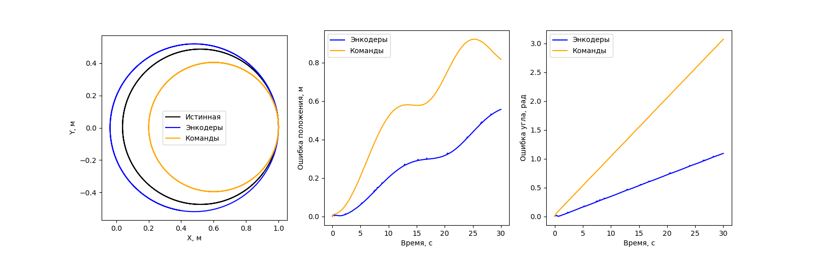
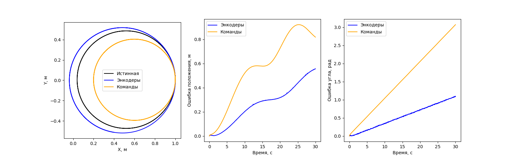
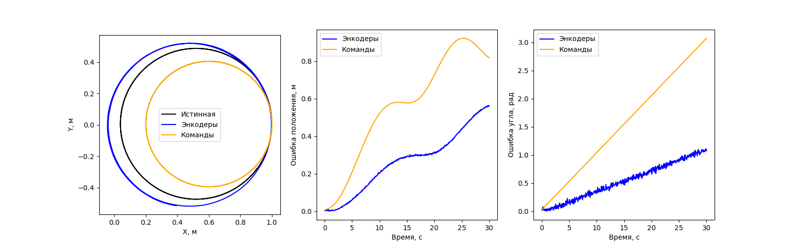

# Практическая работа 3.

## Сборка


```bash
cd ~/practices_ws
rosdep install --from-paths src/practice-03 --ignore-src -r -y
colcon build --symlink-install --packages-select practice_odometry
source install/setup.zsh
cd src/practice-03
```


## Запуск

Внутри контейнера

```
ros2 launch practice_odometry spawn_robot.launch.py world:=noise_0.wbt
ros2 launch practice_odometry spawn_robot.launch.py world:=noise_0_02.wbt
ros2 launch practice_odometry spawn_robot.launch.py world:=noise_0_1.wbt
```

Сцены отличаются уровнем шума энкодеров: 0, 0.02 и 0.1. По умолчанию значение параметра 0.1

## Результаты

### Без шума



### Шум 0.02 рад



### Шум 0.1 рад



ДДаже без шума расчёты немного ошибаются: робот в симуляторе движется не совсем так, как предсказывают формулы. Поэтому рассчитанная траектория постепенно расходится с настоящей.

Когда добавляем шум энкодеров, показания вращения колёс начинают колебаться. Из-за этого рассчитанные положение и направление робота тоже колеблются. Это видно на графике ошибки угла при шуме 0.1