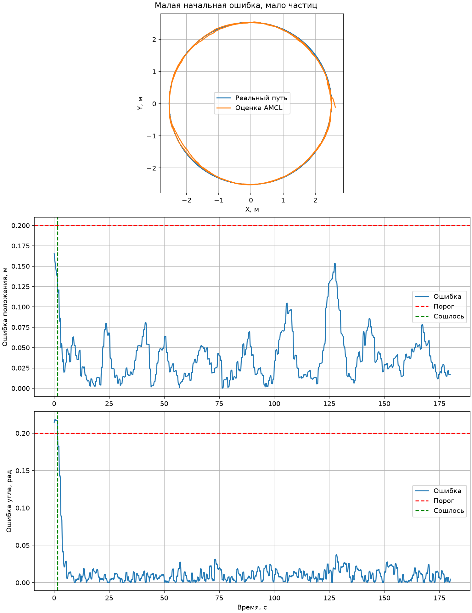
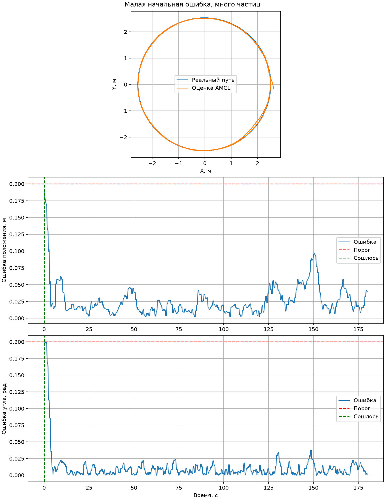
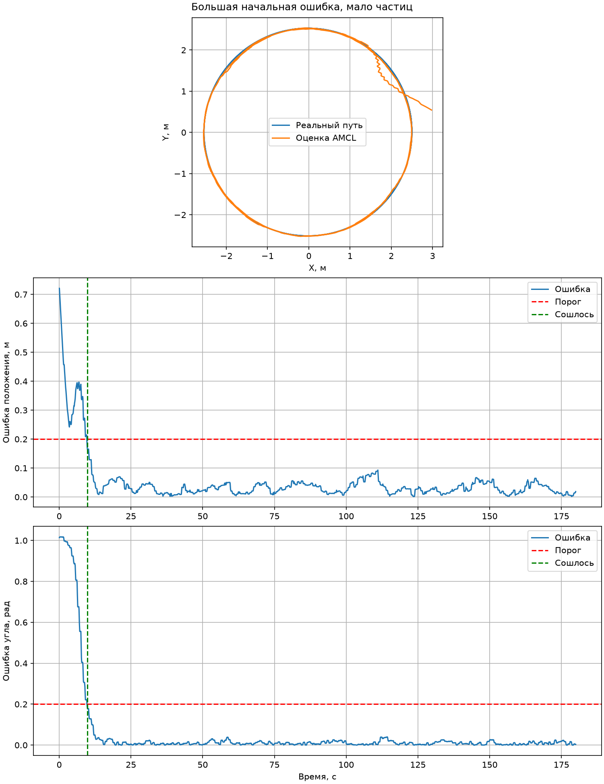
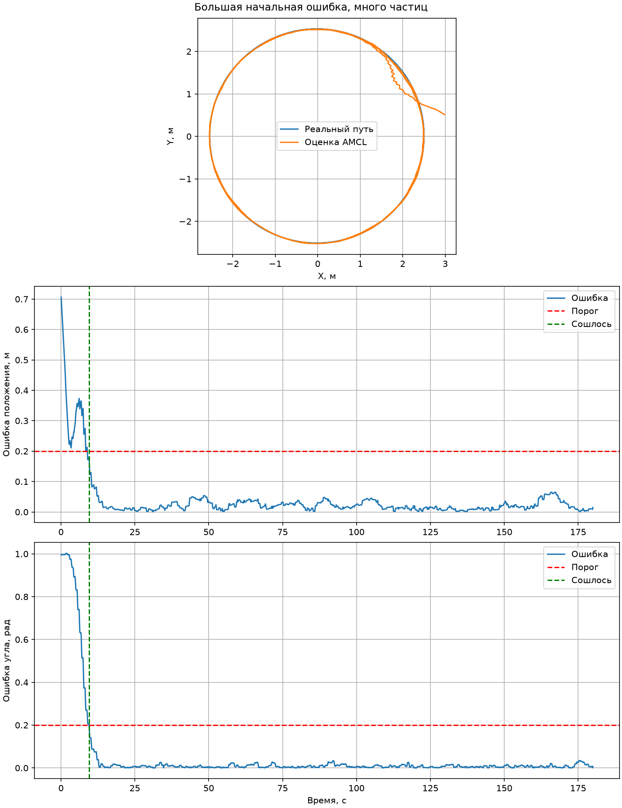
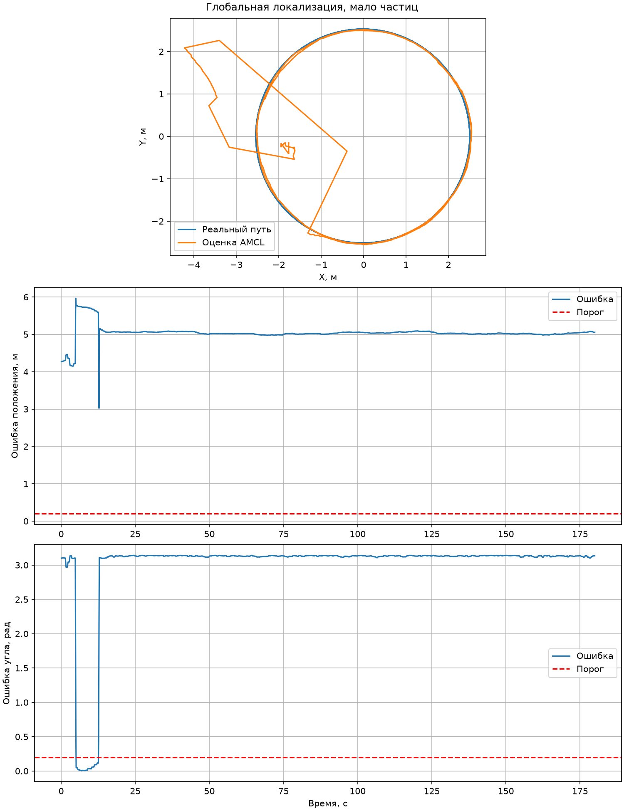
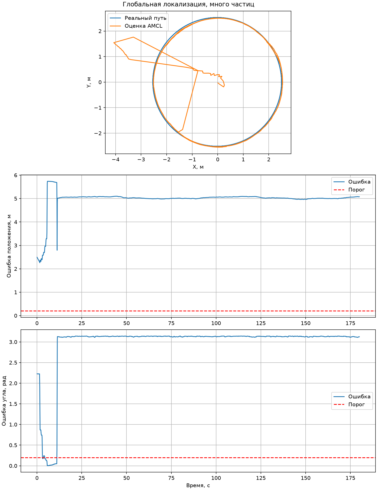

# Практика 4

Вариант 02

## Сборка и запуск

Команды для bash внутри контейнера курса:

```bash
source /opt/ros/jazzy/setup.bash
cd ~/practices_ws
rosdep install --from-paths src/practice-04 --ignore-src -r -y
colcon build --symlink-install --packages-select practice_localization
source install/setup.bash
cd src/practice-04
```

Один запуск с Webots и RViz. В `experiment` можно подставить любое название из таблицы ниже:

```bash
ros2 launch practice_localization spawn_robot.launch.py experiment:=initial_small_low output_dir:="$PWD/results"
```

Все шесть запусков по очереди, без RViz и отрисовки сцены:

```bash
ros2 run practice_localization run_experiments --output-dir "$PWD/results"
```

## Параметры

- Мало частиц: `min_particles = 300`, `max_particles = 1000`. Много: `500` и `10000`.
- Малая начальная ошибка `(x, y, yaw)`: `(0.15 м, −0.15 м, 0.2 рад)`. Большая: `(0.5 м, 0.5 м, 1 рад)`.
- Один эксперимент — 180 секунд симуляции, примерно 2,27 круга. Скорости: 0,2 м/с и 0,08 рад/с.
- Пороги сходимости: 0,2 м и 0,2 рад. Обе ошибки должны оставаться в пределах порогов 10 секунд подряд. Время считается от начала этого интервала относительно первой оценки после инициализации AMCL.

Пороги проверены на предварительном запуске. Во всех шести экспериментах они одинаковые. Остальные настройки AMCL находятся в `config/amcl.yaml` и между запусками не меняются. Разрешение карты — 0,01 м.

## Результаты

В `results` лежат CSV с позами и ошибками, JSON с параметрами и PNG с тремя графиками каждого запуска.

| experiment | Время сходимости, с |
|---|---:|
| initial_small_low | 1,664 |
| initial_small_high | 0,064 |
| initial_large_low | 9,760 |
| initial_large_high | 9,568 |
| global_low | Не сошёлся за 180 с |
| global_high | Не сошёлся за 180 с |








[Анализ результатов](ANALYSIS.md)
